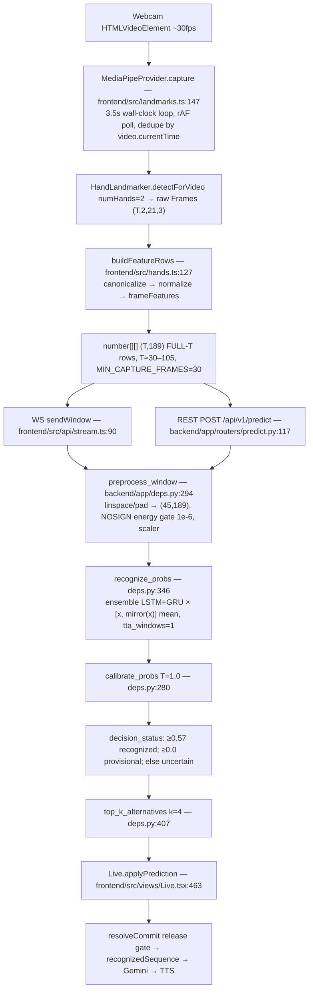

# SignBridge AI — Static vs Dynamic Sign Recognition: Pipeline Audit

**Date:** 2026-10-20 · **Type:** Read-only code audit (no code modified during audit) · **Spec for fix plan:** `Docs/plans/2026-10-20-temporal-motion-fixes.md`

Trigger: live webcam observations — signs held still sometimes recognized; the same signs performed with natural movement often fail or misclassify; low confidences; expected signs missing from alternatives. The hypothesis under audit: the pipeline may classify individual frames instead of temporal movement.

## Pipeline (end-to-end, as implemented)

## Stage evidence (file:function)

| Stage | Location | Finding |
|---|---|---|
| Capture | `frontend/src/landmarks.ts` `capture` | 3.5 s continuous multi-frame sequence (`CAPTURE_WINDOW_MS=3500`, `MIN_CAPTURE_FRAMES=30`), camera-rate frames deduped by `video.currentTime`; NOT one/some stills |
| Features | `frontend/src/hands.ts` `frameFeatures` | 189 dims = 126 wrist-normalized xyz + 42 per-landmark speed magnitudes + 21 hand-shape stats; speed measured in normalized space vs previous frame |
| Normalization | `hands.ts` `normalize` | Per-frame, wrist-relative shift + hand-size max-norm — spatial only, no temporal statistics |
| Transport | `api/stream.ts`, `routers/predict.py` | Full-T ordered rows; no flattening |
| Resample | `backend/app/deps.py` `preprocess_window` | `np.linspace(0, T-1, 45)` when T≥45 (order preserved); short T → **last non-zero frame** repeat-pad; energy gate `< 1e-6` → No-Sign |
| Model | `ai/models/lstm.py`, registry `SBAI-MDL-ISL-4.0.0` | `Input(shape=(45,189))` + Masking + LSTM(128→64)/GRU(128→64) — **sequence model, not single-frame classifier**; ensemble mean over LSTM, GRU, and mirror-TTA |
| Training data | `scripts/build_tensors_v3.py`, `data/dataset/processed/tensors_109_real.npz` | n=14,826 **ordered video-clip** landmark sequences (T,2,21,3) from ISL500; no still-image training path; signer-disjoint 8800/2397/3629 split |
| Class metadata | `data/dataset/annotations/class_map.csv` | All 109 rows `sign_type=Dynamic` — blanket label, not a validated static/dynamic annotation |
| Confidence | `deps.py` `calibrate_probs` | Softmax max-prob, temperature 1.0 (identity, `fit_rejected: true`) |
| Policy | `models/SBAI-MDL-ISL-4.0.0/policy.json` | `accept_threshold=0.57`, `provisional_threshold=0.0`, `tta_windows=1` — "Uncertain" never fires live; everything <0.57 is Provisional |
| Masking | Keras logs (`Docs/eval/08_webcamsim_test.txt`) | "LSTM/GRU does not support masking and will destroy the mask"; pad values are non-zero so Masking is inert anyway |

## Verified conclusion

**Temporal order DOES reach the model.** Chain: ordered capture (`landmarks.ts`) → ordered features incl. per-frame speeds (`hands.ts`) → ordered transport → monotone linspace resample (`deps.py`) → stacked LSTM/GRU over the 45-step axis (`lstm.py`). "Single-frame classifier" is **false at architecture level**.

## Verified contributing facts (code/artifact evidence)

1. **Global hand trajectory is erased before the model.** Wrist-relative + size normalization per frame makes pure whole-hand translation produce identical coordinates and ~zero speed; only handshape change and rotation *relative to wrist* survive. Speed features are also computed in normalized space — path through signing volume is not encoded.
2. **3.5 s window includes reaction + idle time.** Webcam-sim: `full_sign` 0.822 vs `idle_realistic` 0.769 (idle dilution measured); motion-energy head/tail trim was tried and **gate-failed** (M13 §4.2) — not safely removable today.
3. **One prediction per whole capture** (`tta_windows=1`); early static portion and late motion are collapsed by linspace to 45 points.
4. **`provisional_threshold=0.0`** → every score in [0, 0.57) is Provisional; Uncertain never fires.
5. **Blanket `sign_type=Dynamic`** on all 109 classes — no static/dynamic-aware grouping in metrics or thresholds.
6. Worst frozen-TEST classes are motion/location confusable pairs: SIT F1≈0.17 (→Chair 22), EAT 0.36 (→Food 16), CAR 0.56 (→Bus 17) (`Docs/eval/08_final_test_per_class.csv`).

## Hypotheses (plausible, NOT confirmed)

| # | Hypothesis | How to test |
|---|---|---|
| H1 | Signs whose lexical content is location/trajectory (Sit, Walk, Go, Car) suffer most because FV-1.0 erases global path | Ablation: synthetic global translation pre-normalize (invariance check) vs trajectory-sensitive feature channel retrain |
| H2 | Live webcam under-performs offline replay (MediaPipe noise, lighting, framing) | Fill `Docs/eval/webcam_truth.csv` protocol (PENDING human) |
| H3 | Reaction delay → signing starts after window begins; continuous mode compounds with 600 ms buffer | Countdown/pre-roll experiment; idle_realistic sim |
| H4 | One policy for all signs (no static/dynamic awareness) hides group-specific weaknesses | Re-tag classes; per-group metrics |
| H5 | Mirror-TTA ensemble overconfidently prefers static-looking shape classes | Calibration by motion-energy bins |

**The static-vs-dynamic concern from webcam testing remains a hypothesis** pending the fix plan's controlled evaluations (motion-probe suite, gated ablation) and the live checklist. Not a confirmed root cause.

## Fix plan (approved, P0–P3)

See `Docs/plans/2026-10-20-temporal-motion-fixes.md`. Priorities: P0 measure first (motion probes + baseline), P0 trajectory feature ablation with numeric activation gates (VAL ≥ 0.8231, TEST ≥ 0.8029, webcam-sim full_sign ≥ 0.8122 — all must pass or 4.0.0 stays active), P1 capture countdown + policy-honesty UI note, P2 preprocessing pin tests + motion-energy group metrics, P3 do not re-enable rejected TTA/motion-trim.

## Limitations of this audit

- No live camera run in audit environment — webcam claims are offline h5 replay or code reading only.
- `.keras` weights not loaded for `model.summary()` — architecture cited from builders + registry + Keras logs.
- Dataset motion statistics not recomputed during audit.
- Linguistic validity of blanket `sign_type` unreviewed.
- Masking interpretation from log text + code path, no dedicated mask test yet (pin tests added by fix plan Task 10).

## Deferred: padding/mask hygiene (P2)

Padding/mask hygiene (P2): model-side mask fix deferred — requires retrain because recurrent layers destroy the Keras mask and pad is a non-zero last-frame copy; current behavior is pinned by `tests/test_preprocess_window_pins.py`.

## Implementation Status

Plan executed 2026-10-20: `Docs/plans/2026-10-20-temporal-motion-fixes.md` (P0–P3, tasks 0–12). Ledger: `.superpowers/sdd/2026-10-20-temporal-motion-fixes/progress.md`.

| Task | Status | Evidence |
| --- | --- | --- |
| 0 Audit doc | Done | this document |
| 1 Motion probes | Done | `backend/app/eval_probe.py`, `tests/test_eval_probe.py` |
| 2 Motion-sensitivity baseline | Done | `Docs/eval/motion_sensitivity.json` |
| 3 Feature v2 (Python twin) | Done | `ai/features/build.py::frame_features_v2` (193-dim), `tests/test_frame_features_v2.py` |
| 4 Tensors `--feat v2` | Done | `data/dataset/processed/tensors_109_traj.npz` (14826, 45, 193; y identical to v1) |
| 5 Training plumbing | Done | `--feat-dim` / `--scaler-file` on `train_v3`/`evaluate_v3`, `tests/test_lstm_feat_dim.py`, smoke pass |
| 6 Training + gates | Done — **GATES FAILED** | `Docs/eval/trajectory_ablation_result.md` |
| 7 Activation (4.1.0) | **Not executed (gates failed)** | `SBAI-MDL-ISL-4.0.0` remains active; nothing registered |
| 8 Single-sign countdown | Done | `Live.tsx` (`COUNTDOWN_TICKS=3` × 400 ms, `runCountdown`/`runSingleAttempt`), `Live.test.tsx` +4 tests |
| 9 Settings policy note | Done | `Settings.tsx` server-threshold note, `Settings.test.tsx` |
| 10 Preprocessing pin tests | Done | `tests/test_preprocess_window_pins.py` (3 passed; no drift) + deferred mask note above |
| 11 Motion-energy groups | Done | `backend/app/eval_groups.py`, `tests/test_eval_groups.py`, `Docs/eval/motion_group_metrics.json` |
| 12 Status docs | Done | this section + cross-ref in `Docs/37` §17.1 |

**Gate numbers (Task 6, GRU @ 193-dim):** VAL argmax **0.8214 < 0.8231 — FAIL**; TEST argmax **0.8052 ≥ 0.8029 — PASS**; webcam-sim full_sign not run (verdict already determined by the VAL gate). Overall: FAIL → the 193-dim model was **not** registered or activated; the shipped ensemble `SBAI-MDL-ISL-4.0.0` (TEST argmax 0.8129) stays active. GRU/LSTM artifacts kept under `models/EXP-2026-006-*/` (model id `SBAI-MDL-ISL-4.2.0`, experiment `EXP-2026-006`; 4.1.0/EXP-2026-005 not reused — belongs to the rejected time-jitter candidate).

**Motion-sensitivity (frozen TEST, active model):** full **0.8129** (sanity match), staticify **0.0091** (chance), time_shuffle **0.4274** — temporal order is load-bearing for the shipped model; the "frame-level classifier" reading is quantitatively ruled out offline.

**Motion-energy groups vs frozen TEST per-class F1:** low **0.7819** mean / 0.8108 median (37 classes); mid 0.8216 / 0.8466 (36); high 0.8209 / 0.8468 (36) — low-motion (static-leaning) classes are the weakest group (~4 F1 points below mid/high), consistent with, but not proof of, the static-vs-dynamic concern.

**Shipped regardless of gates:** single-sign readiness countdown (single mode only; continuous mode untouched) and the Settings server-threshold honesty note — both test-covered.

**Verification battery (2026-10-20):** backend `pytest` 147 passed; frontend vitest 60 passed; `npx tsc --noEmit` clean; `git status` shows no modifications to `models/SBAI-MDL-ISL-4.0.0*`, `models/scaler_109_real.npz`, `models/EXP-2026-003*`, or `data/dataset/processed/tensors_109_real.npz` (only new untracked ablation artifacts).

**What remains:** live 15-sign checklist completion + `webcam_truth.csv` (human tester with camera — nothing fabricated here); Gemini real-API run (no `VITE_GEMINI_API_KEY`); model-side mask fix deferred (see above).
