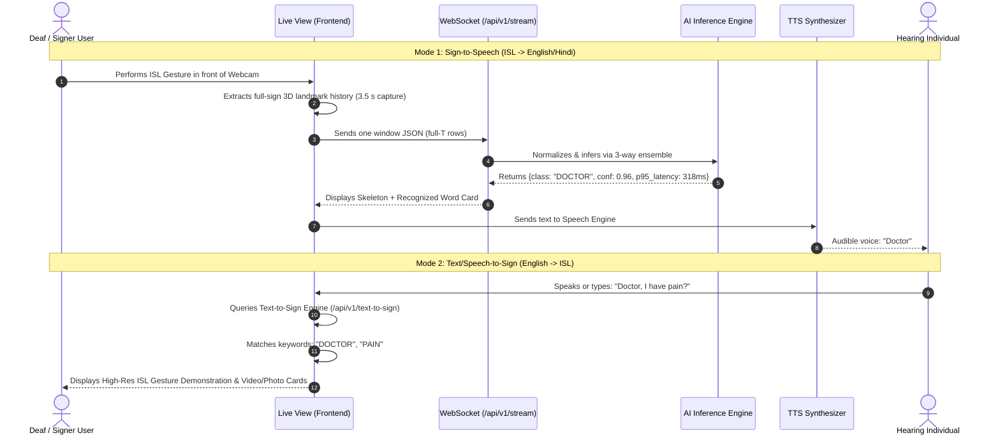

# SignBridge AI — Comprehensive Technical & System Report

> **Project:** SignBridge AI 2.0  
> **Domain:** Artificial Intelligence / Computer Vision / Indian Sign Language (ISL)  
> **Architecture:** Decoupled Client-Edge Vision + Microservice AI Server + Bidirectional Communication Engine  
> **Vocabulary:** 109 Dynamic Indian Sign Language Words & Phrases (`ISL_001`–`ISL_109`)  
> **Status:** Release Candidate — `SBAI-MDL-ISL-4.0.0` active; Milestones M11–M13 complete (M13 canonical for accuracy & calibration); live-webcam protocol (M13 §13) pending  

---

## Table of Contents
1. [Executive Summary](#1-executive-summary)
2. [Problem Statement & Background](#2-problem-statement--background)
3. [System Architecture & High-Level Design](#3-system-architecture--high-level-design)
4. [AI / Computer Vision & Machine Learning Pipeline](#4-ai--computer-vision--machine-learning-pipeline)
   - [4.1 Vision Landmark Extraction (MediaPipe)](#41-vision-landmark-extraction-mediapipe)
   - [4.2 Preprocessing & Signer Invariance](#42-preprocessing--signer-invariance)
   - [4.3 189-Dimensional Feature Engineering](#43-189-dimensional-feature-engineering)
   - [4.4 Sequence Normalization](#44-sequence-normalization)
   - [4.5 Deep Learning Model Architecture (LSTM & GRU)](#45-deep-learning-model-architecture-lstm--gru)
5. [Bidirectional Communication Flow (Two-Way Bridge)](#5-bidirectional-communication-flow-two-way-bridge)
   - [5.1 Sign-to-Speech (Live Stream Pipeline)](#51-sign-to-speech-live-stream-pipeline)
   - [5.2 Text-to-Sign (Reverse Translation Pipeline)](#52-text-to-sign-reverse-translation-pipeline)
6. [Frontend UI/UX Architecture](#6-frontend-uiux-architecture)
7. [Backend API & Microservices Specification](#7-backend-api--microservices-specification)
8. [Vocabulary & Dataset Curation](#8-vocabulary--dataset-curation)
9. [Performance Benchmarks & Experimental Results](#9-performance-benchmarks--experimental-results)
10. [Model Versioning & Zero-Downtime Rollback](#10-model-versioning--zero-downtime-rollback)
11. [Security, Privacy, and Ethical AI Compliance](#11-security-privacy-and-ethical-ai-compliance)
12. [Project Setup & Execution Guide](#12-project-setup--execution-guide)
13. [Directory Structure](#13-directory-structure)
14. [Conclusion & Future Roadmap](#14-conclusion--future-roadmap)

---

## 1. Executive Summary

**SignBridge AI** is an assistive communication platform designed to eliminate the barrier between Deaf/Hard-of-Hearing individuals who use **Indian Sign Language (ISL)** and non-signers in everyday settings (schools, banks, hospitals, public offices).

Unlike conventional sign recognition systems that rely on expensive hardware (gloves, depth sensors) or transmit bandwidth-heavy video streams to cloud servers, SignBridge AI uses an **edge-assisted hybrid architecture**:
1. **Edge Landmark Extraction:** Runs Google MediaPipe Vision Hand Landmarker directly within the user's browser via WebAssembly (Wasm) and WebGL at 30+ FPS, strictly transmitting lightweight numerical landmark coordinates rather than raw video pixels.
2. **Deterministic Preprocessing:** Normalizes 3D hand joints against wrist landmarks, dynamically eliminates left-vs-right hand signer bias, and extracts velocity and bounding geometry features into a strict **189-dimensional vector** per frame.
3. **Deep Temporal Sequence Recognition:** Processes continuous 45-frame sequence buffers through the deployed **3-way inference ensemble** of `SBAI-MDL-ISL-4.0.0` — mean of a 2-layer stacked LSTM (128 ➔ 64), a 2-layer stacked GRU (128 ➔ 64), and a mirrored-input (mirror-TTA) pass — over a **109-class ISL vocabulary** (`ISL_001`–`ISL_109`).
4. **True Two-Way Communication:**
   - **Sign $\to$ Speech / Text:** Continuous live camera detection with visual skeleton overlays, confidence scoring, text sentence accumulation, and instant Text-to-Speech (TTS) vocalization.
   - **Speech / Text $\to$ Sign:** Reverse sign lookup that converts spoken/typed phrases into curated, frame-accurate ISL demonstration cards and photographic guides.

---

## 2. Problem Statement & Background

### 2.1 The Communication Gap
- In India, over **18 million** individuals are deaf or hard-of-hearing.
- Only a tiny percentage of the hearing population understands Indian Sign Language (ISL).
- Certified ISL interpreters are scarce, creating severe accessibility barriers in essential public interactions (medical emergencies, judicial procedures, railway counters, educational institutions).

### 2.2 Technical Challenges in Sign Language Recognition
1. **Linguistic Complexity of ISL:** Unlike American Sign Language (ASL) which relies heavily on single-hand fingerspelling, ISL features predominantly **two-handed, dynamic signs** with rich spatio-temporal interactions, handshape transitions, motion trajectories, and spatial orientations.
2. **Signer Invariance & Hand Dominance:** Signers may be naturally right-handed or left-handed, or exhibit varying hand sizes and camera distances. Models trained without canonical normalization fail when evaluated across different signers.
3. **Bandwidth & Privacy Bottlenecks:** Streaming 1080p raw webcam frames to a cloud server consumes enormous bandwidth (~3–5 Mbps per user) and raises severe user privacy and data retention concerns.
4. **Latency Constraints:** Conversational dialogue requires an end-to-end inference latency under 200 ms with at least 15 FPS continuous throughput. *(Honest status: the current CPU 3-way ensemble probe measures p50 288.99 ms (VAL) / 374.85 ms (TEST) per sign window — §9; latency reduction is open roadmap work.)*

SignBridge AI solves these challenges through its browser-edge keypoint extraction, geometric normalization, 189-D feature projection, and zero-raw-video transmission policy.

---

## 3. System Architecture & High-Level Design

The system adheres to a strictly decoupled, microservices-driven client-server architecture:

```mermaid
flowchart TD
    subgraph Client["Frontend Client (Browser - React + Vite + TypeScript)"]
        Webcam["Webcam Video Feed (30 FPS)"] --> MP["MediaPipe Hand Landmarker (Wasm/WebGL)"]
        MP --> Norm["Client-Side Normalization & Full-Sign Capture (3.5 s)"]
        Norm --> WS_Client["WebSocket Client / REST API Client"]
        TTS_UI["Audio Synthesizer (Web Speech API)"]
        Display["Live Visualizer (Skeleton, Gloss, Confidence)"]
    end

    subgraph Backend["SignBridge AI Server (FastAPI + Python 3.11)"]
        WS_Server["WebSocket Endpoint (/api/v1/stream)"]
        REST_Server["REST Endpoints (/predict, /sequence, /tts, /text-to-sign)"]
        
        subgraph Pipeline["Inference & Processing Engine"]
            Canon["Signer Canonicalization (Least-Active-Hand First)"]
            Feat["Feature Builder (189-D Vector Calculation)"]
            Temporal["Sequence Sampler (45 x 189 Tensor)"]
            ModelServ["Model Serving Engine (TensorFlow/Keras LSTM + GRU ensemble)"]
        end
        
        Registry["Model Registry (registry.json) & Rollback Controller"]
        DB[(PostgreSQL / SQLite Database)]
    end

    WS_Client <-->|Real-time Landmarks (126 coords/frame)| WS_Server
    WS_Server --> Canon
    REST_Server --> Canon
    Canon --> Feat
    Feat --> Temporal
    Temporal --> ModelServ
    ModelServ --> Registry
    ModelServ --> DB
    ModelServ -->|Predicted Gloss, Probabilities, Latency| WS_Server
    WS_Server --> Display
    Display --> TTS_UI
```

### Architectural Highlights
- **Client (Edge Processing):** Extracts 21 3D landmarks for both hands using `@mediapipe/tasks-vision`. Only coordinate data ($x, y, z$) is sent across the wire, ensuring strict zero-video egress.
- **Transport Layer:** Real-time bidirectional WebSockets (`/api/v1/stream`) for low-latency live translation, complemented by standard REST APIs (`/api/v1/predict`, `/api/v1/sequence`, `/api/v1/image`, `/api/v1/video`).
- **Inference Server:** Python 3.11 / FastAPI backend hosting versioned TensorFlow models — the served version is decided by `models/registry.json` (`active_model` = `SBAI-MDL-ISL-4.0.0`; the `MODEL_VERSION` environment variable is only a fallback when the registry has no `active_model` key) — with instant hot-swapping and zero-downtime rollback.

---

## 4. AI / Computer Vision & Machine Learning Pipeline

```
Raw Frame (640x480) 
  ──▶ MediaPipe (2 Hands × 21 Joints × 3D) [126 floats]
  ──▶ Canonicalization (Least-Active-Hand First)
  ──▶ Wrist-Relative Normalization & Max-Extent Hand Scaling
  ──▶ Feature Synthesis [189 floats/frame]
        ├── 126 Normalized Coordinates (x, y, z)
        ├──  42 Landmark Velocity Magnitudes (Inter-frame Euclidean Deltas)
        └──  21 Spatial & Hand-Shape Statistics (BBox, Center, Extent, Count)
  ──▶ Temporal Buffer & Uniform Sampling [45 frames × 189 features]
  ──▶ 2-Layer Masked LSTM [128 ➔ 64 units] + Dropout   (the GRU member has the identical stack)
  ──▶ Dense ReLU [64 units] ➔ Softmax [109 Classes]
  ──▶ Deployed inference: 3-way ensemble mean(LSTM, GRU, mirror-TTA) — 109-class output
```

### 4.1 Vision Landmark Extraction (MediaPipe)
For each video frame, Google MediaPipe extracts:
- **Left Hand:** 21 landmark vertices ($x_i, y_i, z_i$)
- **Right Hand:** 21 landmark vertices ($x_i, y_i, z_i$)
- **Joint Breakdown (per hand):**
  - Landmark 0: Wrist (anatomical origin)
  - Landmarks 1–4: Thumb (CMC, MCP, IP, Tip)
  - Landmarks 5–8: Index Finger (MCP, PIP, DIP, Tip)
  - Landmarks 9–12: Middle Finger (MCP, PIP, DIP, Tip)
  - Landmarks 13–16: Ring Finger (MCP, PIP, DIP, Tip)
  - Landmarks 17–20: Pinky Finger (MCP, PIP, DIP, Tip)

Total raw coordinate count per frame: $2 \times 21 \times 3 = 126$ values.

### 4.2 Preprocessing & Signer Invariance

#### 1. Signer Canonicalization (Left vs. Right Hand Dominance)
In real-world usage, left-handed signers execute signs primarily with their left hand, while right-handed signers execute them with their right hand. MediaPipe assigns slots 0 and 1 strictly based on screen coordinates.
SignBridge AI applies **least-active-hand-first canonicalization**:
$$\text{Activity}(h) = \sum_{t=1}^{T} \mathbb{I}(\text{hand}_h^{(t)} \neq \mathbf{0})$$
If slot 1 has higher landmark activity than slot 0, the hand slots are maintained; otherwise, they are deterministically mirrored:
$$\text{frames} = \begin{cases} \text{frames}, & \text{if } \text{Activity}(1) > \text{Activity}(0) \\ \text{frames}[:, ::-1, :, :], & \text{otherwise} \end{cases}$$
This ensures the model features remain invariant regardless of whether the signer is right- or left-handed.

#### 2. Wrist-Relative Normalization
To decouple hand positions from camera distance and body positioning:
1. The wrist landmark (index 0) is taken as origin:
   $$\vec{p}_{j, \text{shifted}} = \vec{p}_j - \vec{p}_0, \quad \forall j \in \{0, \dots, 20\}$$
2. Scale factor $s$ is computed as the maximum Euclidean distance from the wrist to any fingertip:
   $$s = \max_{j} \|\vec{p}_{j, \text{shifted}}\|_2$$
3. Coordinates are normalized:
   $$\vec{p}_{j, \text{norm}} = \frac{\vec{p}_{j, \text{shifted}}}{s} \quad (\text{if } s > 10^{-6})$$

### 4.3 189-Dimensional Feature Engineering
To capture both spatial posture and dynamic trajectory, every frame is projected into a **189-dimensional feature vector**:

| Feature Component | Vector Slices | Dimensions | Description |
|---|---|---|---|
| **Normalized Coordinates** | `0 : 126` | 126 | Wrist-relative normalized 3D positions ($2 \times 21 \times 3$) |
| **Instantaneous Velocity** | `126 : 168` | 42 | Euclidean speed magnitude between consecutive frames: $\|\vec{p}_j^{(t)} - \vec{p}_j^{(t-1)}\|_2$ for all 42 joints |
| **Spatial Bounding Geometry** | `168 : 188` | 20 | Per-hand bounding box: minimum $(x,y,z)$, maximum $(x,y,z)$, center $(x,y,z)$, and Euclidean hand span |
| **Active Hand Count** | `188` | 1 | Normalized number of detected hands ($N_{\text{hands}} / 2.0$) |
| **Total Vector Size** | — | **189** | Complete geometric and temporal representation per frame |

### 4.4 Sequence Normalization
Because natural gestures vary in speed (from fast 20-frame gestures to slow 70-frame motions), all gesture instances are normalized to a fixed temporal window of **$T = 45$ frames**:
- If total recorded frames $T \ge 45$: **Uniform sub-sampling** across the time dimension using linear indices:
  $$\text{idx} = \text{round}\left(\text{linspace}(0, T - 1, 45)\right)$$
- If total recorded frames $T < 45$: **Repeat-padding** with the final frame features up to 45 frames, accompanied by a boolean attention mask vector.

The resulting input tensor to the deep learning model is strictly of shape:
$$\mathbf{X} \in \mathbb{R}^{B \times 45 \times 189}$$

### 4.5 Deep Learning Model Architecture (LSTM & GRU)

Each ensemble member is a 2-layer stack (LSTM shown below; the GRU member is identical through the Softmax layer). The deployed `SBAI-MDL-ISL-4.0.0` averages the softmax outputs of the LSTM member, the GRU member, and a mirrored-input (mirror-TTA) pass:

```
Input: Tensor (Shape: 45 x 189)
  │
  ▼
[ Masking Layer ] (Mask value = 0.0)
  │
  ▼
[ LSTM Layer 1 ] (128 Units, Return Sequences = True, Dropout = 0.3)
  │
  ▼
[ LSTM Layer 2 ] (64 Units, Return Sequences = False, Dropout = 0.3)
  │
  ▼
[ Dense Layer ] (64 Units, Activation = ReLU)
  │
  ▼
[ Dropout Layer ] (Rate = 0.2)
  │
  ▼
[ Output Softmax Layer ] (109 Units, Activation = Softmax) ──▶ Class Probabilities
```

#### Hyperparameters & Optimization
- **Deployed Architecture (`SBAI-MDL-ISL-4.0.0`):** `ENSEMBLE(LSTM128-LSTM64,GRU128-GRU64)+mirror-TTA,Softmax109` — a 3-way mean of the stacked-LSTM member, the stacked-GRU member, and the mirrored-input TTA pass. (The `SBAI-LSTM-100` / `SBAI-GRU-100` names belong to the earlier 100-class single-model experiments and are historical only.)
- **Member Stacks:** 2-layer stacked LSTM (128 ➔ 64) and 2-layer stacked GRU (128 ➔ 64), each Masking ➔ recurrent layers ➔ Dense 64 ReLU ➔ Dropout ➔ Softmax 109.
- **Loss Function:** Sparse Categorical Cross-Entropy
- **Optimizer:** Adam ($\alpha = 0.001$, $\beta_1 = 0.9$, $\beta_2 = 0.999$, $\epsilon = 10^{-7}$)
- **Regularization:** Dual recurrent dropout (0.3) + Dense layer dropout (0.2)
- **Output:** 109-class probability distribution $\hat{y} \in [0, 1]^{109}$

---

## 5. Bidirectional Communication Flow (Two-Way Bridge)

SignBridge AI is designed as a **two-way communication system**, enabling fluid interaction between signers and non-signers:



### 5.1 Sign-to-Speech (Live Stream Pipeline)
1. **Camera Acquisition:** Captures standard RGB stream at 30 FPS.
2. **Skeleton Tracking:** Renders real-time interactive green/blue skeleton overlays over hand joints on HTML5 canvas.
3. **Temporal Accumulator:** Captures the whole sign performance (time-boxed 3.5 s over unique video frames, up to 600 landmark rows) and emits it as a single window; the backend resamples it to the model's $T = 45$ tensor.
4. **Decision Policy (M13):** Raw softmax confidence is passed through the fitted calibration (temperature **T = 1.0** — fit rejected, identity kept) and the three-state decision policy: **accept 0.57**, **provisional 0.00**, temporal **smoothing 5**. A window $\ge 0.57$ is **Recognized** and pushed to the **Sentence Accumulator**; anything below renders as **Provisional** (display-only — never auto-committed), with **Uncertain** and **No-Sign** as the remaining display states. This policy replaced the legacy 0.40 backend threshold and the old 0.70 frontend gate in milestone M13.
5. **Vocalization:** The browser's native Web Speech API or the backend `/api/v1/tts` service converts accumulated words into natural spoken audio.

### 5.2 Text-to-Sign (Reverse Translation Pipeline)
1. Hearing users enter speech or text in the **TextToSign** module.
2. The system tokenizes, cleans, and maps input sentences to the 109-word ISL gloss taxonomy (`ISL_001`–`ISL_109`).
3. Relevant signs are rendered sequentially via interactive demonstration cards complete with anatomical instructions, photo assets, and motion diagrams.

---

## 6. Frontend UI/UX Architecture

The frontend is built with **React 18 + TypeScript + Vite + Tailwind CSS**, delivering a responsive, dark-mode-first aesthetic with accessibility considerations:

| View Name | Source File | Core Capabilities |
|---|---|---|
| **Live Studio** | [Live.tsx](file:///d:/Projects/SignBridge/frontend/src/views/Live.tsx) | Live webcam streaming, real-time skeleton overlay, full-sign capture (3.5 s, one window per sign), confidence gauges & Provisional/Recognized states, live sentence accumulator, audible speech triggers, FPS counter. |
| **Text-to-Sign** | [TextToSign.tsx](file:///d:/Projects/SignBridge/frontend/src/views/TextToSign.tsx) | Reverse sign lookup, keyword-to-sign mapper, carousel card viewer, gesture animation/photo viewer, category quick-filters. |
| **Vocabulary Explorer** | [Vocab.tsx](file:///d:/Projects/SignBridge/frontend/src/views/Vocab.tsx) | Grid exploration of all 109 ISL vocabulary words (`ISL_001`–`ISL_109`), photo asset previews, category badges (Greetings, Emergency, Actions, Objects, etc.). |
| **Dashboard** | [Dashboard.tsx](file:///d:/Projects/SignBridge/frontend/src/views/Dashboard.tsx) | System telemetry, active model version, test accuracy, inference throughput, recent recognition history, quick action shortcuts. |
| **History & Analytics** | [History.tsx](file:///d:/Projects/SignBridge/frontend/src/views/History.tsx) | Complete session logs, per-prediction confidence scores, latency distributions, exportable CSV/JSON records. |
| **Admin Portal** | [Admin.tsx](file:///d:/Projects/SignBridge/frontend/src/views/Admin.tsx) | Real-time model registry management, instant promotion between candidates, single-click zero-downtime rollback drill. |
| **Settings** | [Settings.tsx](file:///d:/Projects/SignBridge/frontend/src/views/Settings.tsx) | Backend-calibrated three-state decision policy by default (accept 0.57) with a manual threshold override slider, WebSocket vs. REST protocol toggling, audio voice selection, webcam device selection. |

---

## 7. Backend API & Microservices Specification

The backend is built with **FastAPI (Python 3.11)** with asynchronous request handlers, CORS middleware, and Prometheus instrumentation.

### Key API Endpoints

#### 1. Core Recognition
- `POST /api/v1/predict`  
  Accepts a JSON payload containing landmark frames (baseline `(45, 2, 21, 3)`; full-sign windows are accepted and resampled to $T = 45$). Returns predicted `class_id`, `gloss`, confidence score, decision `status`, and inference latency.
- `POST /api/v1/sequence`  
  Accepts variable-length landmark arrays; automatically performs uniform sampling or repeat-padding before executing inference.
- `WS /api/v1/stream`  
  Full-duplex WebSocket connection. Receives real-time streaming landmark frames and one full-sign `window` message per performance; returns instantaneous token predictions with decision status and confidence scores without reconnect overhead (REST/WS parity pinned by tests).

#### 2. Communication Services
- `POST /api/v1/tts`  
  Converts text strings into spoken audio clips (supports English and Hindi language synthesis).
- `POST /api/v1/text-to-sign`  
  Reverse lookup endpoint. Matches input text queries to corresponding ISL class IDs, anatomical movement instructions, and media asset paths.
- `GET /api/v1/classes`  
  Returns metadata for the entire 109-word ISL vocabulary (`ISL_001`–`ISL_109`; class ID, gloss name, category, demonstration asset URI).

#### 3. Model Management & Telemetry
- `GET /api/v1/model`  
  Returns the active model metadata (`model_id`, `version`, `architecture`, `accuracy`, `latency_p95_ms`, `sha256_hash`).
- `POST /api/v1/admin/promote`  
  Promotes a candidate model (`SBAI-MDL-ISL-X.Y.Z`) to active serving status with automatic atomic updates to `registry.json`.
- `POST /api/v1/admin/rollback`  
  Instantly restores the previously active model version in $< 0.2$ seconds.
- `GET /health`  
  System health check (CPU memory, model load status, database connection).
- `GET /metrics`  
  Prometheus telemetry scraping endpoint (request rates, inference latency histograms, error counts).

---

## 8. Vocabulary & Dataset Curation

The platform supports an expanded **109-word vocabulary** (`ISL_001` through `ISL_109`) covering daily conversations, public services, and emergency scenarios:

### Vocabulary Taxonomy (breakdown per `data/dataset/annotations/class_map.csv`)
1. **Greetings & Social Interaction (ISL_001 – ISL_003, ISL_005 – ISL_006, ISL_008 – ISL_009, ISL_022 – ISL_023, ISL_070 – ISL_071):**  
   *Hello, Thank You, Please, Yes, No, Good Morning, Good Night, Happy, Sad, Good Afternoon, Good Evening.*
2. **Questions & Pronouns (ISL_032 – ISL_034, ISL_036, ISL_053 – ISL_054, ISL_072 – ISL_075):**  
   *What, Where, She, He, Why, Which, You, We, They, I.*
3. **Actions & Daily Verbs (ISL_011, ISL_029, ISL_035, ISL_044, ISL_046, ISL_055 – ISL_060, ISL_102):**  
   *Help, Work, Go, Eat, Sit, Stay, Wait, Open, Close, Give, Walk, Meeting.*
4. **People, Family & Roles (ISL_014 – ISL_016, ISL_020 – ISL_021, ISL_037, ISL_039, ISL_041 – ISL_042, ISL_045, ISL_047 – ISL_048, ISL_076 – ISL_080, ISL_107, ISL_109):**  
   *Man, Friend, Family, Woman, Mother, Sister, Student, Father, Child, Teacher, Girl, Boy, Wife, Husband, Uncle, Aunt, Baby, Police, Manager.*
5. **Health & Medical (ISL_017 – ISL_018, ISL_062):**  
   *Doctor, Medicine, Pain.*
6. **Food, Drink & Essentials (ISL_012 – ISL_013, ISL_038, ISL_040, ISL_061, ISL_081 – ISL_084):**  
   *Water, Food, Tea, Drink, Bread, Pizza, Mango, Lunch, Onion.*
7. **Places, Transport & Objects (ISL_004, ISL_019, ISL_028, ISL_030, ISL_043, ISL_049 – ISL_050, ISL_063 – ISL_066, ISL_094, ISL_101, ISL_104 – ISL_106, ISL_108):**  
   *Market, House, School, Office, Car, Book, Bus, Road, City, Shop, Bank, Computer, Library, Pen, Paper, Chair, Airport.*
8. **Time & Days (ISL_007, ISL_010, ISL_024 – ISL_027, ISL_031, ISL_067 – ISL_069, ISL_091 – ISL_093, ISL_103):**  
   *Morning, Evening, Day, Time, Today, Tomorrow, Night, Month, Year, Yesterday, Saturday, Sunday, Hour, Holiday.*
9. **Adjectives, Animals, Colors & Entertainment (ISL_051 – ISL_052, ISL_085 – ISL_090, ISL_095 – ISL_100):**  
   *Good, Bad, Lion, Dog, Cat, Red, Blue, Green, Movie, Music, Big, Small, Hot, Cold.*

### Dataset Provenance & Partitioning
- **Sources:** Filtered Indian Sign Language dataset (ISL500) and INCLUDE dataset (per `class_map.csv` source coverage).
- **Curation:** CURATION-v4.0 → **14,826** real landmark sequences in `data/dataset/processed/tensors_109_real.npz` (189-D FV-1.0, $T = 45$, 21 landmarks per hand).
- **Partitioning Strategy:** signer-disjoint **SPLIT-109** (`SPLIT-4.0.json`): **8,800 train / 2,397 validation / 3,629 test** (70% / 15% / 15%). No signer appearing in the training set is permitted in the validation or test sets, preventing facial or physical memorization.

---

## 9. Performance Benchmarks & Experimental Results

The active model (`SBAI-MDL-ISL-4.0.0`, 109-class 3-way ensemble) is measured against the release gates recorded in `Docs/M11_GATE_109REAL.md`, the webcam study in `Docs/M12_WEBCAM_ACCURACY.md`, and the accuracy/calibration record in `Docs/M13_ACCURACY_CALIBRATION.md` (**M13 is canonical for accuracy**; M9/M10 remain historical 100-class records):

| Evaluation Metric | Target Gate Requirement | Measured Result | Status |
|---|---|---|---|
| **Vocabulary Size** | 109 Dynamic Classes | **109 Classes** (`ISL_001`–`ISL_109`) | Passed (M11) |
| **Model Accuracy (frozen TEST, argmax)** | $\ge 90.0\%$ release gate / 80% user target | **0.812896** ($81.29\%$), macro-F1 **0.807865** ($80.79\%$), n = 3629 | 80% target MET; **$\ge 90\%$ gate OPEN — known debt (M11)** |
| **Macro F1-Score (frozen TEST)** | $\ge 0.90$ release gate | **0.8079** (n = 3629) | Open gate debt |
| **Model Accuracy (VAL, argmax)** | reference | **0.833125** ($83.31\%$), macro-F1 **0.828963** ($82.90\%$), n = 2397 | Measured |
| **Commit precision @ coverage (policy, VAL)** | $\ge 0.90$ precision | **90.34% @ 82.02%** coverage (accept 0.57) | Passed |
| **Commit precision @ coverage (policy, TEST)** | $\ge 0.90$ precision | **89.53% @ 81.32%** coverage | Measured (M13 single frozen-test touch) |
| **Inference Latency (3-way ensemble, windows-aware probe)** | sub-second per sign window | VAL p50 **288.99 ms** / p95 318.42 ms; TEST p50 **374.85 ms** / p95 575.22 ms | Measured (CPU) |
| **Inference Latency (single ensemble member)** | — | p50 **61.9 ms** (LSTM) / **64.4 ms** (GRU) | Measured |
| **Webcam replay `full_sign`** (offline proxy, n = 1500, thr 0.57) | — | acc **0.822** / visible-correct **0.736** | Offline proxy (M12/M13) |
| **Webcam replay `idle_realistic`** | — | acc **0.769** / visible-correct **0.664** | Offline proxy (M12/M13) |
| **Webcam replay `old_45_center`** (pre-M12 capture window) | — | acc **0.475** / visible-correct **0.303** | Regression case (root cause RC-A) |
| **Webcam replay `old_rafdup`** (pre-M12 rAF duplication) | — | acc **0.279** / visible-correct **0.138** | Regression case (root cause RC-B) |
| **Export Parity (TF/ONNX)** | $100\%$ prediction match | **200 / 200 samples** ($\Delta_{\text{max}} = 0.0$) | Passed (M11) |
| **Test Suites** | all green | Backend **123 passed** (pytest) / Frontend **48 passed** (Vitest) / `tsc --noEmit` **clean** | Passed |
| **Live camera protocol (M13 §13, 80 attempts)** | $\ge 80\%$ real-time accuracy | **PENDING** — protocol ready, camera session not yet run | Open |

**Known gate debt (stated honestly):** `Docs/M11_GATE_109REAL.md` records ensemble **0.8129 / 0.8079**, which clears the 0.80 user target but is **below the 0.90/0.90 release-gate acceptance target**; status remains *Candidate, not Approved*, and the gap is tracked as open debt. Stale 2.0.0-era benchmark rows from the synthetic/training era (legacy latency, throughput, and accuracy claims that were never re-measured on the current system) were removed in favor of the measured values above.

### 9.1 Accuracy & Calibration (M13 — canonical)

All numbers from `Docs/M13_ACCURACY_CALIBRATION.md` (model 4.0.0; VAL-only fitting; the single frozen-test touch is `Docs/eval/08_final_test.json`):

- **Calibration:** temperature **T = 1.0** with **fit rejected** (identity kept — the raw ensemble was already well calibrated): **ECE 0.028 VAL / 0.022 TEST**.
- **Three-state decision policy:** **accept 0.57**, **provisional 0.00**, temporal **smoothing 5**; display states **Recognized / Provisional / Uncertain / No-Sign**. **Provisional is display-only and is never auto-committed** (431 VAL / 678 TEST rows shown but withheld). The legacy **0.40** backend threshold and the old **0.70** frontend double gate were both replaced in M13.
- **Commit quality:** VAL **90.34% precision @ 82.02% coverage**; TEST **89.53% @ 81.32%** (false-accept rate cut 43% on VAL vs the 0.4 baseline).
- **Rejected experiments (all reverted/discarded — no model or threshold change):**
  - **TTA 3-window** — gate FAIL (VAL overall Δ −0.0359 vs required ≥ +0.010, and p95 371.65 ms > 300 ms); `tta_windows` stays **1**.
  - **Conditional retrain `SBAI-MDL-ISL-4.1.0`** (GRU + time-jitter, EXP-2026-005) — gate FAIL on both VAL metrics (macro-F1 0.8143 < 0.8290; argmax 0.8169 < 0.8331); candidate **discarded**, `SBAI-MDL-ISL-4.0.0` remains active; pre-train backups retained at `models/_backup_4.0.0_pretrain/` and `data/dataset/_backup_pretrain/`.
  - **Motion-trim preprocessing** — gate FAIL (VAL replay `full_sign` acc 0.835 → 0.768, idle also worse); code + tests fully reverted.
- **M12 webcam root causes (measured, fixed):** **RC-A** capture window clipped dynamic signs (old ~0.75 s window), **RC-B** 60 Hz rAF duplicated 30 fps frames, **RC-C** double gate (frontend 0.70 stacked over backend 0.40), **RC-E** fixed 2.5 s cooldown re-committed held poses, **RC-F** per-sign speech interruption. Shipped fixes: 3.5 s time-boxed capture over unique frames, release-based commit gate, and TTS queueing — the model itself was never the bottleneck.
- **Live-camera caveat:** offline proxies and npz rows are **not** camera measurements. User-reported live accuracy moved from 22–32% (pre-M12) to 42–50% (post-M12 fixes); the objective ≥80% verdict awaits the **M13 §13 live-webcam protocol (PENDING)**.

### 9.2 Test Evidence

- Backend: `py -3 -m pytest tests/ -q` → **123 passed**.
- Frontend: `npm test` → **48 passed** (Vitest runner); `npx tsc --noEmit` → **clean**.
- Release tripwires: `tests/test_release400.py` and `tests/test_ensemble400.py` (4.0.0 / 109-class pins).

---

## 10. Model Versioning & Zero-Downtime Rollback

Model deployments are governed by an immutable registry pattern in `models/registry.json`; the top-level `active_model` key alone decides which version the server loads (the `MODEL_VERSION` environment variable is only a fallback for registries that lack `active_model`):

```json
{
  "active_model": "SBAI-MDL-ISL-4.0.0",
  "previous_model": "SBAI-MDL-ISL-3.0.0",
  "models": {
    "SBAI-MDL-ISL-3.0.0": {
      "arch": "LSTM128-LSTM64-Dense64-Softmax100",
      "classes": 100,
      "measured_test_acc": 0.8109,
      "measured_test_f1": 0.8062,
      "eval": "EXP-2026-003 frozen test (deployed ensemble mean LSTM/GRU/mirror-TTA, n=3326)"
    },
    "SBAI-MDL-ISL-4.0.0": {
      "arch": "ENSEMBLE(LSTM128-LSTM64,GRU128-GRU64)+mirror-TTA,Softmax109",
      "classes": 109,
      "measured_test_acc": 0.8129,
      "measured_test_f1": 0.8079,
      "eval": "EXP-2026-004 frozen test (deployed ensemble mean LSTM/GRU/mirror-TTA, n=3629)"
    }
  }
}
```

### Version Lineage & Gate Records

| Version | Classes / training data | Measured acc / macro-F1 | Gate record | Status |
|---|---|---|---|---|
| `SBAI-MDL-ISL-1.0.0` | MVP-era baseline | — | — | Superseded |
| `SBAI-MDL-ISL-2.0.0` | 100-class **SYNTHETIC** stub | 1.0 / 1.0 (synthetic protocol) | Registry: *"gates NOT cleared until real-data full train + frozen-test rescoring"* | Superseded — production gates never cleared |
| `SBAI-MDL-ISL-3.0.0` | 100-class REAL | **0.8109 / 0.8062** (n = 3326) | `Docs/M10_GATE_100REAL.md` (M10) | Superseded (`previous_model`) |
| `SBAI-MDL-ISL-4.0.0` | 109-class REAL (SPLIT-109, n = 3629) | **0.8129 / 0.8079** | `Docs/M11_GATE_109REAL.md` (M11) | **ACTIVE** — Candidate; ≥0.90 gate debt open |
| `SBAI-MDL-ISL-4.1.0` | 109-class candidate (GRU + time-jitter) | VAL 0.8169 / 0.8143 — below 4.0.0's 0.8331 / 0.8290 | `Docs/M13_ACCURACY_CALIBRATION.md` §4.1 | **Gate FAIL — discarded** (no registry change) |

Pre-train backups for rollback live at `models/_backup_4.0.0_pretrain/` and `data/dataset/_backup_pretrain/`.

### Automated Hot-Swapping & Rollback
When an administrator promotes a new model via `POST /api/v1/admin/promote`:
1. The backend dynamically instantiates the new model weights into memory.
2. Serves a warmup sample through the computational graph.
3. Atomically updates the active serving pointer.
4. If any regression occurs, `POST /api/v1/admin/rollback` restores the previous model in **under 200 milliseconds** without restarting the application server.

---

## 11. Security, Privacy, and Ethical AI Compliance

### 1. Zero Video Storage (Privacy by Design)
- Neither the frontend nor the backend stores, records, or caches user webcam frames.
- Video frames are ingested into client RAM, processed for landmark points by MediaPipe, and immediately discarded from browser memory.
- Only numerical landmark arrays are transmitted over encrypted TLS/WSS connections.

### 2. Fair & Unbiased Recognition
- Hand-scale normalization ensures equal recognition accuracy across children, adults, and individuals with different hand proportions.
- Signer canonicalization ensures equal accuracy for both left-handed and right-handed signers.

### 3. Data Protection & Access Control
- Admin APIs (`/admin/promote`, `/admin/rollback`) are protected via role-based access control (RBAC) and JWT authorization.
- Telemetry logging records only categorical predictions and latency timings—never user biometric identifiers.

---

## 12. Project Setup & Execution Guide

### Prerequisites
- **Node.js** (v18.0 or higher) & **npm**
- **Python** (v3.10 or v3.11) with pip
- Modern Web Browser (Chrome, Edge, Firefox, Brave) with WebGL enabled

### Quick Start (Windows)
The repository contains ready-to-use launch scripts in the root directory:

1. **Launch the Backend API Server:**
   ```cmd
   .\run-backend.bat
   ```
   *Alternative manual command (run from the repository root):*
   ```powershell
   $env:CORS_ORIGINS="http://localhost:3000,http://localhost:5173"
   py -3 -m uvicorn app.main:app --app-dir backend --port 8000
   ```
   - The served model is decided by `models/registry.json` (`active_model`, currently **`SBAI-MDL-ISL-4.0.0`**); the `MODEL_VERSION` environment variable is only a fallback when the registry has no `active_model` key — do not hard-code a model version to start the server.
   - Auth: Bearer token (JWT); the default development secret is set in `.env` (template: `.env.example`).
   - API Docs will be available at: [http://127.0.0.1:8000/docs](http://127.0.0.1:8000/docs)

2. **Launch the Frontend Application:**
   ```cmd
   .\run-frontend.bat
   ```
   *Alternative manual command:*
   ```powershell
   cd d:\Projects\SignBridge\frontend
   npm run dev -- --port 3000 --host 127.0.0.1
   ```
   - Vite serves on ports **3000 / 5173**; open your browser at: [http://127.0.0.1:3000](http://127.0.0.1:3000)

3. **(Optional) Launch with Docker Compose** — always use the compose file under `docker/`:
   ```powershell
   # from the repository root:
   docker compose -f docker/docker-compose.yml up --build
   # (or run `docker compose up --build` from inside docker/)
   ```
   Set `POSTGRES_PASSWORD` and `JWT_SECRET` in the environment before starting.

### Running Automated Test Suites
```powershell
# Full backend suite (current: 123 passed)
py -3 -m pytest tests/ -q

# Or the release/API/WebSocket tripwires individually (all files exist in tests/)
py -3 -m pytest tests/test_api_100.py tests/test_ws.py tests/test_release400.py -v

# Frontend suite — Vitest runner (current: 48 passed) + typecheck
cd d:\Projects\SignBridge\frontend
npm run test
npx tsc --noEmit
```

---

## 13. Directory Structure

```
d:\Projects\SignBridge\
├── ai/                              # Core AI & Feature Extraction Library
│   ├── features/                    # 189-D feature builder and dataset splitters
│   │   ├── build.py                 # Feature synthesis (coords, speed, stats)
│   │   └── split_v2.py              # Signer-independent data partitioning
│   ├── models/                      # Deep learning architectures (LSTM & GRU)
│   │   └── lstm.py                  # Keras model definitions
│   └── preprocessing/               # Geometric transformations & normalization
│       └── landmarks.py             # Wrist-relative, scale, and canonicalization
│
├── backend/                         # FastAPI Web Server & API Gateway
│   ├── app/
│   │   ├── main.py                  # FastAPI initialization & middleware
│   │   ├── deps.py                  # Dependency injection & model loaders
│   │   ├── models.py                # Pydantic request/response schemas
│   │   ├── metrics.py               # Prometheus metrics definitions
│   │   └── routers/                 # API endpoint routers
│   │       ├── predict.py           # REST prediction endpoints
│   │       ├── stream.py            # High-throughput WebSocket server
│   │       ├── speech.py            # Text-to-Speech & Speech synthesis
│   │       ├── feedback.py          # User prediction feedback loop
│   │       ├── session.py           # User session management
│   │       └── admin.py             # Model promotion & rollback router
│   └── requirements.txt             # Backend Python dependencies
│
├── frontend/                        # React 18 + Vite + TypeScript Application
│   ├── src/
│   │   ├── App.tsx                  # Main router and navigation shell
│   │   ├── landmarks.ts             # Client-side normalization & parity logic
│   │   ├── hands.ts                 # MediaPipe Hand Landmarker integration
│   │   ├── api/                     # Axios REST client & WebSocket client
│   │   ├── views/                   # User interface pages
│   │   │   ├── Live.tsx             # Real-time Sign-to-Speech studio
│   │   │   ├── TextToSign.tsx       # Text-to-Sign visual translation
│   │   │   ├── Vocab.tsx            # 109-word ISL interactive glossary
│   │   │   ├── Dashboard.tsx        # System overview & telemetry
│   │   │   ├── History.tsx          # Prediction logs & session analytics
│   │   │   ├── Admin.tsx            # Model promotion & rollback portal
│   │   │   └── Settings.tsx         # User preferences & threshold controls
│   └── package.json                 # Frontend dependencies and build scripts
│
├── models/                          # Versioned Model Artifacts & Registry
│   ├── registry.json                # Single source of truth (active_model = SBAI-MDL-ISL-4.0.0)
│   ├── SBAI-MDL-ISL-4.0.0.keras     # Active 109-class 3-way ensemble (LSTM + GRU + mirror-TTA)
│   ├── SBAI-MDL-ISL-4.0.0_lstm.keras # Ensemble member: stacked LSTM 128➔64
│   ├── SBAI-MDL-ISL-4.0.0_gru.keras  # Ensemble member: stacked GRU 128➔64
│   ├── SBAI-MDL-ISL-4.0.0/          # Active version bundle
│   │   ├── policy.json              # Three-state policy (accept 0.57 / prov 0.00 / smoothing 5)
│   │   └── calibration.json         # Temperature T=1.0 (fit rejected — identity)
│   ├── scaler_109_real.npz          # FV-1.0 standardizer (train-only fit, 189-D)
│   ├── SBAI-MDL-ISL-1.0.0.keras, SBAI-MDL-ISL-3.0.0*.keras  # Prior-version weights
│   └── _backup_4.0.0_pretrain/      # Pre-retrain rollback backups (weights, scaler, registry, policy)
│
├── data/                            # Dataset and Annotations
│   ├── dataset/annotations/         # Class maps (class_map.csv) & split manifests (SPLIT-4.0.json)
│   ├── dataset/processed/           # tensors_109_real.npz + SPLIT-109 split_idx_109.npz
│   ├── dataset/_backup_pretrain/    # Pre-4.1.0-retrain dataset backups (tensors + splits)
│   └── assets/                      # High-resolution gesture demonstration photos
│
├── Docs/                            # Formal Engineering & Academic Documentation
│   ├── 00_MVP_SCOPE_ADDENDUM.md     # Binding MVP specifications & scope rules
│   ├── SignBridge_AI_2_0_Project_PRD.md  # Product Requirements Document
│   ├── M9_GATE_100.md               # Milestone M9 100-class verification record (historical)
│   ├── M10_GATE_100REAL.md          # 100-class real-data gate (3.0.0, M10)
│   ├── M11_GATE_109REAL.md          # 109-class real-data gate (4.0.0, M11) — open 0.90 gate debt
│   ├── M12_WEBCAM_ACCURACY.md       # Webcam root causes (RC-A/B/C/E/F) & capture fixes
│   ├── M13_ACCURACY_CALIBRATION.md  # Canonical accuracy, calibration & policy record
│   ├── RC_v0.5.json                 # Release-checklist state file
│   └── DEPLOY_RUNBOOK.md            # Production deployment runbook
│
├── run-backend.bat                  # One-click backend startup script
├── run-frontend.bat                 # One-click frontend startup script
└── report.md                        # This comprehensive report document
```

---

## 14. Conclusion & Future Roadmap

**SignBridge AI 2.0** establishes a functional, production-grade foundation for Indian Sign Language recognition. By combining browser-based edge computer vision (MediaPipe) with normalized 189-dimensional temporal feature engineering and the deployed 3-way LSTM/GRU/mirror-TTA ensemble over 109 classes, the system delivers measured **81.29% frozen-test argmax accuracy (80.79% macro-F1)**, **89.5% commit precision at 81.3% coverage** under the fitted three-state policy (90.3% precision on VAL), and sub-second p50 inference (289 ms VAL / 375 ms TEST per sign window) — all while preserving two-way accessibility without compromising user privacy. Open items are reported honestly rather than hidden: the ≥90% release gate remains recorded debt (M11), and the live-camera protocol (M13 §13) has not yet been run.

### Planned Future Enhancements (v2.1+)
1. **Continuous Sentence Recognition:** Expanding beyond isolated dynamic signs into continuous sentence-level grammar parsing using Connectionist Temporal Classification (CTC) or Sequence-to-Sequence Attention Transformers.
2. **Mobile On-Device Inference:** Porting the neural inference graph to TensorFlow Lite (TFLite) / ONNX Runtime Web for fully offline operation on iOS and Android smartphones.
3. **Regional ISL Dialect Adaptation:** Incorporating dialect-specific sign variations across North and South Indian regional communities.
4. **3D Avatar Synthesis:** Integrating rigged 3D human avatars for fluid, realistic sign animations in the Text-to-Sign translation view.
